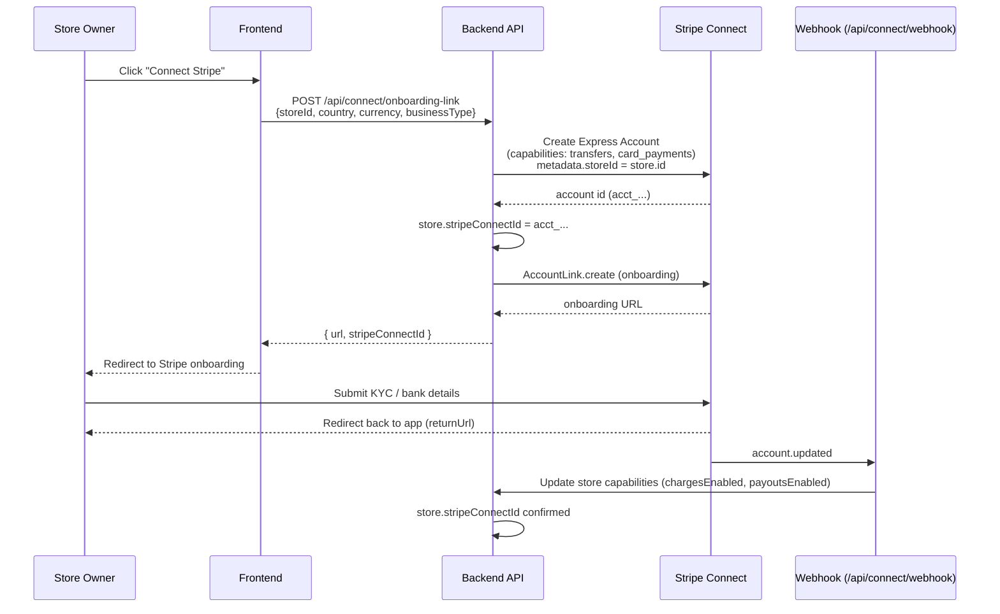
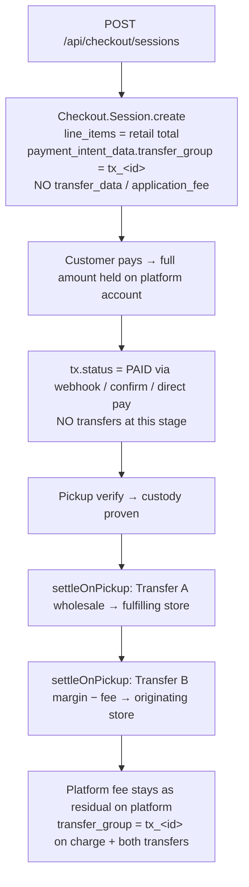
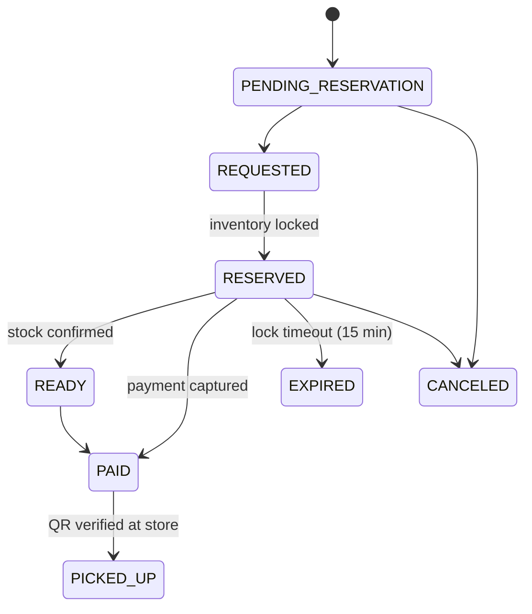
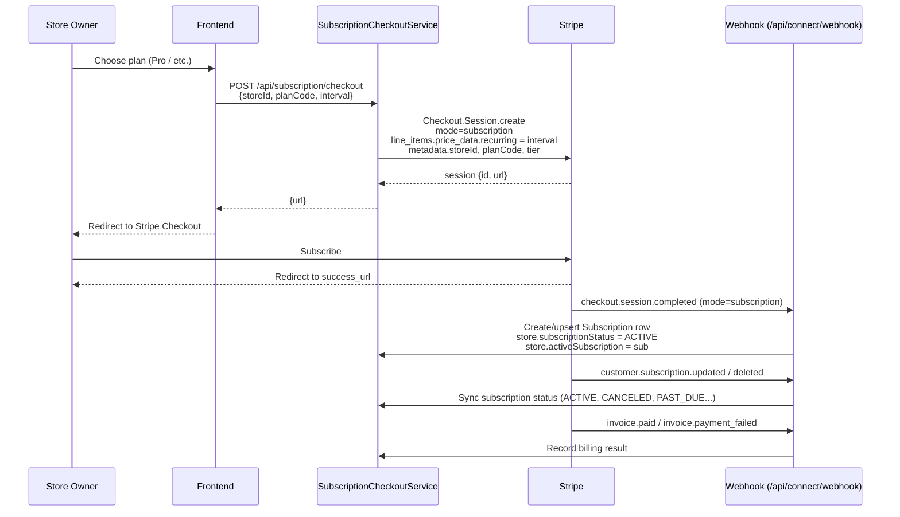

# Payment Workflow

This document describes how payments move through the DinRetail (Linked-Store) platform. There are two distinct money flows:

1. **Marketplace split-ledger payments** — a customer buys a product listed by one store (the *originating* store) that is physically fulfilled by another store (the *fulfilling* store). The wholesale amount goes to the fulfilling store, the arbitrage margin goes to the originating store, and the platform takes the remainder.
2. **Platform subscription payments** — a store pays DinRetail a recurring SaaS fee for a subscription tier.

Both flows are built on **Stripe** and **Stripe Connect (Express accounts)**.

---

## 1. Actors

| Actor | Stripe entity | Role |
|---|---|---|
| Platform (DinRetail) | Platform Stripe account | Owns the marketplace, receives platform fees & subscription revenue |
| Store | Stripe Express Connect account (`acct_...`) | Receives wholesale payout (fulfilling store) / arbitrage margin (originating store) |
| Customer | Cardholder / Stripe Checkout | Pays the retail price |

---

## 2. Store Onboarding (Stripe Connect)

Before a store can receive payouts it must onboard a Stripe Express account.

### Sequence



### Key endpoints

- `POST /api/connect/onboarding-link` — creates (or reuses) a Stripe Express account and returns an onboarding URL.
- `POST /api/connect/login-link` — opens the store owner's Stripe Express dashboard (only after onboarding is complete).
- `GET /api/connect/health` — reports whether Stripe Connect is activated on the platform account.

A store is considered **onboarded** when its `stripeConnectId` is set, non-blank, and does **not** start with the placeholder `acct_connected_`. In **Payment Flow 2**, no money moves to any store at checkout — the full retail amount is held on the platform, and onboarded stores receive their payout via explicit Transfers at verified pickup. Stores that are not onboarded simply skip their transfer at pickup (settlement is reported as partial and can be retried).

---

## 3. Customer Purchase (Marketplace Split Ledger)

### Money split

A single retail price is split three ways. In **Payment Flow 2 ("Hold on Platform & Split at Product Pickup")** the customer's payment is captured and **held entirely on the platform account**; nothing is paid out until the product is picked up.

| Leg | Recipient | When paid | Stripe object |
|---|---|---|---|
| Wholesale payout (Transfer A) | Fulfilling store (product owner) | At **pickup / custody proof** | `Transfer.create(source_transaction)` |
| Arbitrage margin (Transfer B) | Originating store (broker), minus platform fee | At **pickup / custody proof** | `Transfer.create(source_transaction)` |
| Platform fee | Platform | **Residual** — never transferred; simply remains on the platform balance | — |

All three legs share the transaction's `transfer_group` (`tx_<transactionId>`), which is also set on the charge itself, so the whole lifecycle can be reconciled (and reversed) as one group.

### End-to-end sequence

```mermaid
sequenceDiagram
    participant Cust as Customer
    participant FE as Frontend
    participant BE as CheckoutController
    participant Svc as CheckoutService
    participant Stripe as Stripe
    participant WH as Webhook (/api/connect/webhook)
    participant Staff as Store Staff
    participant Pick as PickupController

    Cust->>FE: Select product, click Buy
    FE->>BE: POST /api/checkout/sessions<br/>{productId, variantId?, originatingStoreId}
    BE->>BE: Create Transaction (RESERVED)<br/>Create InventoryLock (HELD, 15 min)<br/>Create QrToken, assign runner
    BE->>Stripe: Checkout.Session.create<br/>mode=payment<br/>line_items = retail total (1 item)<br/>payment_intent_data.transfer_group = tx_&lt;id&gt;<br/>(no transfer_data, no application_fee_amount)
    Stripe-->>BE: session {id, url}
    BE-->>FE: {id, url, status}
    FE-->>Cust: Redirect to Stripe Checkout
    Cust->>Stripe: Pay
    Stripe-->>Cust: Redirect to success_url
    Stripe->>WH: checkout.session.completed
    WH->>Svc: finalizeTransactionPaidAfterStripe(txId, piId)
    Svc->>BE: tx.status = PAID<br/>InventoryLock → RELEASED_TO_SALE<br/>Generate QrToken if missing, assign runner<br/>(NO transfers — funds stay on platform)
    Svc-->>BE: Broadcast PAID event (SSE)
    Cust->>Staff: Show QR / 8-digit code at store
    Staff->>Pick: POST /api/pickup/verify {secureToken or fallbackCode}
    Pick->>BE: Validate QR (unused, unexpired)<br/>Mark scanned<br/>tx.status = PICKED_UP
    Pick->>Svc: settleOnPickup(tx)
    Svc->>Stripe: Transfer A: wholesale → fulfilling store<br/>(transfer_group = tx_&lt;id&gt;, source_transaction = ch_...)
    Svc->>Stripe: Transfer B: margin − platform fee → originating store<br/>(transfer_group = tx_&lt;id&gt;, source_transaction = ch_...)
    Note over Svc,Stripe: Platform fee remains on the platform balance (residual)
    Pick-->>Staff: {status: settled, wholesaleTransferId, stripeTransferId, platformFeeCents}
```

### Checkout session creation details

The single endpoint `POST /api/checkout/sessions` branches on whether a `transactionId` is supplied:

- **`transactionId` present** → `createSplitLedgerSession`: the transaction already exists (e.g. created via the reservation flow). Reuses the stored wholesale / margin amounts.
- **`transactionId` absent** → `createSingleAccountSession`: builds the transaction inline from `productId` + `variantId`, computing `retailCents`, `wholesaleCents` (default `60%` of retail if missing), and `marginCents = retail − wholesale`.

In both paths the Stripe Checkout line item is **always exactly one item at the retail total**. The wholesale and margin are never surfaced to the customer — they are only moved later, at pickup, via explicit post-custody Transfers. Both paths set `payment_intent_data.transfer_group = tx_<transactionId>` on the charge and store the settlement mode `hold-on-platform` in the session metadata.

### Settlement strategy (single Flow 2 path)



### Payment confirmation paths

The transaction reaches `PAID` through one of three channels:

1. **Webhook (primary):** Stripe posts `checkout.session.completed` (or `checkout.session.async_payment_succeeded`) to `/api/connect/webhook`.
2. **Frontend poll:** After redirect to `success_url`, the frontend calls `POST /api/checkout/confirm-session-paid {sessionId}`. The backend retrieves the session from Stripe, verifies `paymentStatus=paid`, and calls `finalizeTransactionPaidAfterStripe`.
3. **Direct PaymentIntent:** `POST /api/checkout/pay` creates and confirms a Stripe PaymentIntent directly (used by the embedded card flow), then finalizes.

All three converge on `CheckoutService.finalizeTransactionPaidAfterStripe(transactionId, paymentIntentId)`, so the post-payment state machine is identical regardless of entry point. In Flow 2 this method **never** creates transfers — it only marks the transaction `PAID` and prepares the pickup QR token; the money stays on the platform until `PickupController` calls `settleOnPickup`.

### Transaction state machine



---

## 4. Pickup & Custody Proof

The **entire retail amount is held by the platform** until the customer physically picks up the goods. This is the "custody proof" model: the fulfilling store has the inventory, the originating store listed it, and **both** the wholesale payout and the arbitrage margin only move once the customer confirms receipt.

### Pickup flow

```mermaid
flowchart LR
    A[Customer arrives at fulfilling store] --> B[Shows QR token or 8-digit fallback code]
    B --> C[Store staff scans / enters code]
    C --> D[POST /api/pickup/verify]
    D --> E{QR valid &amp; unscanned?}
    E -- No --> F[Reject: invalid / expired / already_scanned]
    E -- Yes --> G[Mark QR scanned<br/>tx.status = PICKED_UP]
    G --> H[settleOnPickup]
    H --> I[Transfer A: wholesale → fulfilling store<br/>transfer_group = tx_&#60;id&#62;, source_transaction = ch_...]
    H --> J[Transfer B: margin − platform fee → originating store<br/>transfer_group = tx_&#60;id&#62;, source_transaction = ch_...]
    I --> K[Platform fee stays as residual on platform]
    J --> K
    K --> L[Return status=settled<br/>{wholesaleTransferId, stripeTransferId, platformFeeCents}]
```

The QR token (`secureToken`, prefix `ls_`) and a human-readable 8-digit `fallbackCode` are generated at reservation time and stored in `qr_tokens`. The token expires after 60 minutes; the inventory lock expires after 15 minutes.

Both transfers are created with `source_transaction` set to the original charge (`ch_...`, resolved from the payment intent's `latest_charge`) so they draw from the payment's funds even while those funds are still pending. Both carry the `route` metadata (`WHOLESALE_TO_FULFILLING` / `MARGIN_TO_ORIGINATING`) used by the refund/reversal module to identify each leg.

If a transfer fails (e.g. a store is not yet onboarded, or Stripe rejects the call), the endpoint returns `picked_up_not_settled`; the affected leg must be settled manually via the Stripe dashboard. Because the QR scan is claimed atomically (`markAsScannedIfNotAlreadyScanned`), `settleOnPickup` runs **at most once per transaction**, preventing double payout.

---

## 5. Platform Subscription Payments

Stores pay DinRetail a recurring subscription fee for platform features. This is a separate Stripe flow using Checkout Sessions in `subscription` mode.



The subscription plan catalog is seeded by `SubscriptionPlanSeeder` and managed via `AdminSubscriptionPlanController`. The store's subscription status gates monthly order limits (`SubscriptionLimitService`).

---

## 6. Webhook Endpoint

All Stripe events arrive at a single endpoint:

```
POST https://vicinity24api.com/api/connect/webhook
```

It is `permitAll()` in `SecurityConfig` (Stripe is the caller, not a user) and verifies the `Stripe-Signature` header using `STRIPE_WEBHOOK_SECRET`.

### Handled events

| Event | Handler | Effect |
|---|---|---|
| `account.updated`, `account.external_account.*` | `handleAccountUpdated` | Sync store `stripeConnectId`, `chargesEnabled`, `payoutsEnabled` |
| `checkout.session.completed`, `checkout.session.async_payment_succeeded` | `handleCheckoutSessionCompleted` | Finalize purchase (`PAID`) or activate subscription |
| `customer.subscription.created/updated/deleted/paused/resumed/trial_will_end` | `handleCustomerSubscriptionEvent` | Sync subscription status & period dates |
| `invoice.paid` | `handleInvoicePaidEvent` | Record successful billing |
| `invoice.payment_failed` | `handleInvoicePaymentFailedEvent` | Record failed billing |

If `STRIPE_WEBHOOK_SECRET` is not set, signature verification is skipped with a warning — **do not run this in production**.

---

## 7. Worked Example: Store Onboarding → Customer Purchase (Flow 2)

**Setup:**
- Store A ("Mama's Bakery", the *originating* store) lists a cake at **$20 retail**.
- Store B ("Corner Cafe", the *fulfilling* store) holds the physical inventory; wholesale price recorded as **$12**.
- Arbitrage margin = $20 − $12 = **$8** to Store A.
- Assume the platform runs in **FEE_BASED** mode at **10%** → platform fee = 10% × $8 = **$0.80**, so Store A receives **$7.20** and the platform keeps **$0.80** as the residual.

### Step 1 — Store B onboards Stripe

1. Store B's owner clicks **Connect Stripe** in the dashboard.
2. Frontend calls `POST /api/connect/onboarding-link { storeId: B, country: "US", currency: "USD", businessType: "individual" }`.
3. Backend creates a Stripe Express account `acct_fulfillB`, sets `storeB.stripeConnectId = "acct_fulfillB"`, and returns an onboarding URL.
4. Owner completes KYC on Stripe; Stripe posts `account.updated`; backend confirms `chargesEnabled=true`, `payoutsEnabled=true`.

### Step 2 — Store A onboards Stripe

Same as Step 1 → `storeA.stripeConnectId = "acct_originA"`.

### Step 3 — Customer buys the cake

1. Customer selects the cake and clicks **Buy**.
2. Frontend calls `POST /api/checkout/sessions { productId, variantId, originatingStoreId: A }`.
3. Backend:
   - Creates `Transaction { originatingStoreId: A, fulfillingStoreId: B, totalRetailCents: 2000, wholesalePayoutCents: 1200, arbitrageMarginCents: 800, status: RESERVED }`.
   - Creates `InventoryLock { variantId, status: HELD, expiresAt: +15min }`.
   - Creates `QrToken { secureToken: "ls_...", fallbackCode: "12345678", expiresAt: +60min }`.
   - Creates a Stripe Checkout Session with:
     - `line_items`: 1 × cake @ $20.00
     - `payment_intent_data.transfer_group`: `"tx_<id>"`
     - **no** `transfer_data` and **no** `application_fee_amount` (Flow 2 holds the full amount on the platform)
     - `metadata.transactionId`: the new transaction id, `metadata.settlementMode`: `hold-on-platform`
4. Customer is redirected to Stripe Checkout and pays $20.
5. Stripe captures the **full $20 and holds it on the platform account**. Nothing has moved to Store A or Store B yet.
6. Stripe posts `checkout.session.completed` → webhook → `finalizeTransactionPaidAfterStripe(txId, piId)`.
   - `tx.status = PAID`.
   - `InventoryLock` → `RELEASED_TO_SALE`.
   - QR token already exists; runner assigned.
   - **No transfers created.**
   - Broadcasts `PAID` SSE event.

### Step 4 — Customer picks up the cake (custody proof)

1. Customer arrives at Store B and shows the QR code (or 8-digit code `12345678`).
2. Store B staff scans it → `POST /api/pickup/verify { secureToken: "ls_..." }`.
3. Backend:
   - Validates token (unused, unexpired) and marks it scanned.
   - `tx.status = PICKED_UP`.
   - Resolves the original charge `ch_...` from the payment intent.
   - **Transfer A:** `Transfer { amount: 1200, destination: "acct_fulfillB", transferGroup: "tx_<id>", source_transaction: "ch_...", metadata.route: "WHOLESALE_TO_FULFILLING" }` → **$12 wholesale to Store B**.
   - **Transfer B:** `Transfer { amount: 720, destination: "acct_originA", transferGroup: "tx_<id>", source_transaction: "ch_...", metadata.route: "MARGIN_TO_ORIGINATING" }` → **$7.20 net margin to Store A**.
   - The **$0.80 platform fee is the residual** that stays on the platform balance.
4. Response: `{ status: "settled", wholesaleTransferId: "tr_...A", stripeTransferId: "tr_...B", platformFeeCents: 80 }`.

### Final money positions

| Party | Received |
|---|---|
| Customer | Paid $20, received cake |
| Store B (fulfilling) | $12 wholesale (Transfer A, at pickup) |
| Store A (originating) | $7.20 net margin = $8 margin − $0.80 platform fee (Transfer B, at pickup) |
| Platform | $0.80 fee retained as residual (FEE_BASED mode); $0 in SUBSCRIPTION mode (Stripe processing fees deducted separately) |

---

## 8. Configuration

| Env var | Purpose |
|---|---|
| `STRIPE_SECRET_KEY` | Platform API key |
| `STRIPE_PUBLISHABLE_KEY` | Frontend publishable key |
| `STRIPE_WEBHOOK_SECRET` | Webhook signature verification (`whsec_...`) |
| `STRIPE_PLATFORM_FEE_PERCENT` | Default platform fee percent |

Set in Render backend environment variables. The webhook URL to register in the Stripe dashboard is:

```
https://vicinity24api.com/api/connect/webhook
```
